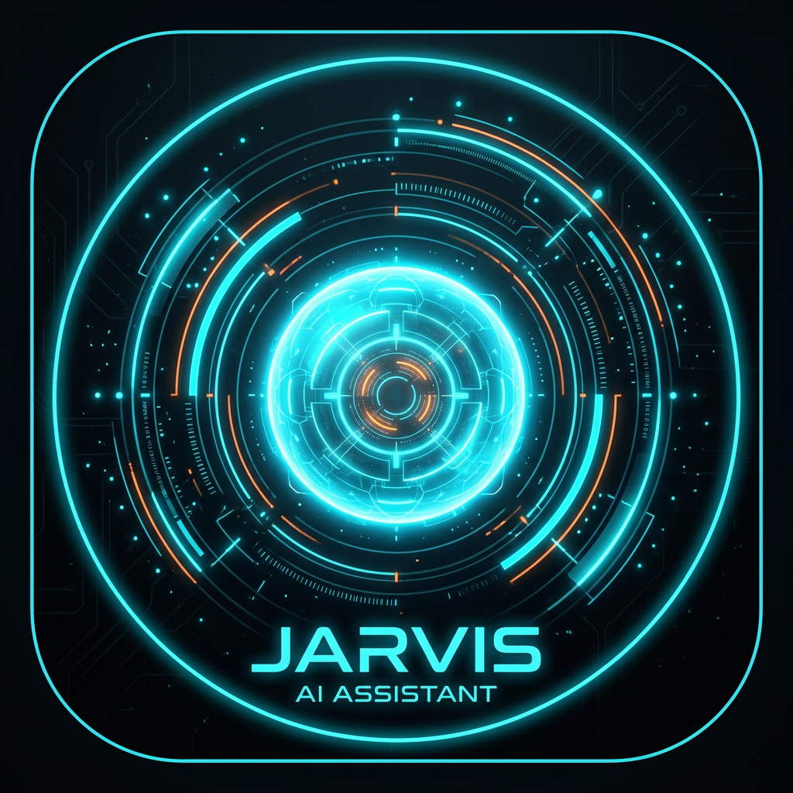

# KaAi v2.0 — Kaan Özkurt imzalı Jarvis Asistan (Gemini 3 Stable)

> **Kurucu: Kaan Özkurt** — Otomatik dinlemeli, derin erkek sesli, her cevabı “Efendim,” ile başlayan masaüstü AI. **Gemini 3** ile en stabil.



**Yenilik (v2.0):** Tüm eski `gemini-2.0/1.5` ve `preview-03-25` modelleri silindi → **Gemini 3 nesli** (3.8 Flash, 3.5 Flash, 4 Argon). `is not found` hatası tamamen düzeltildi, otomatik fallback zinciri eklendi. Mikrofon izni artık gerçek `getUserMedia` ile istenir, HUD’da canlı ses dalgası (AudioContext Analyser) ile konuşma %100 algılanır. Ekran görüntüsü, tam PC erişimi, “bıraktım sen yap” otomasyonu eklendi.

---

## ✨ Özellikler

- **Google Gemini 3** — 6 stabil model: `3.8 Flash (önerilen)`, `3.5 Flash`, `4 Argon (en güçlü)`, `2.5 Pro`, `2.5 Flash`, `2.5 Flash-Lite`. Eski modeller otomatik migrate edilir, hata verirse fallback dener.
- **Gerçek mikrofon izni** — İlk konuşmada tarayıcı izin ister, HUD banner: *“İZİN VER & DİNLE”*. Reddedilirse adres çubuğundan açma yönergesi. `getUserMedia` + `AnalyserNode` ile gerçek ses seviyesi orb’a yansır.
- **Otomatik dinleme V2** — `continuous: true` + 1.4sn VAD + AudioContext ses eşiği. Konuşunca algılar, sessizlikte gönderir, konuşma bitince orb yeniden dinler.
- **Derin erkek sesi** — Rate 0.92 / Pitch 0.82 + Tolga/Murat öncelikli + test butonu. Orb konuşurken halka pulse.
- **Tam PC Erişimi** — Dosya gezgini (oluştur/oku/yaz/sil/aç), komut çalıştır, uygulama aç, **ekran görüntüsü al** (`desktopCapturer`), “masaüstüne not oluştur” sesli komut, “ekranımı gör” ile canlı önizleme + AI yorum.
- **“Bıraktım” otomasyonu** — *“Bıraktım, sen hallet”* deyince KaAi devralır: dosya oluşturur, ekranı kontrol eder, işi bitirir.
- **HUD v2.0** — Scanline, mic permission banner, audio bars (gerçek mic), sol menü senkron pulse, basit SVG harita, scanline.

---

## 📦 Kurulum — Windows

```bat
git clone https://github.com/kralinyo50-blip/KaAi.git
cd KaAi
npm install
npm start              # dene — ilk açılışta mikrofon izni ver
# AYARLAR → API Anahtarı Al → yapıştır → KAYDET
npm run build:win       # → dist/KaAi-Setup-2.0.0-x64.exe
```
Python: `pip install -r requirements.txt` → `python app.py` → `build_python_exe.bat`

---

## 🔑 API Anahtarı — Tek Tık

KaAi → **AYARLAR** üstte **API ANAHTARI AL →** → aistudio.google.com/app/apikey → *Create API key* → kopyala → KAYDET.

---

## 🎙️ Ses — İzin Sorunu Düzeltildi

- İlk açılışta **“İZİN VER & DİNLE”** banner çıkar — tıkla, tarayıcı izin sorar, onayla.
- Reddedersen banner kalır, adres çubuğu 🔒 → Mikrofon: İzin Ver.
- İzin sonrası `AnalyserNode` ile gerçek ses dalgası HUD’da oynar, orb yeşile döner (DİNLİYOR).

---

## 🧠 Modeller (Gemini 3)

| Model | Açıklama |
|---|---|
| **Gemini 3.8 Flash** | Önerilen — en yeni stabil 2026 |
| **Gemini 4 Argon** | En güçlü frontier |
| **Gemini 3.5 Flash** | Popüler dengeli |
| **Gemini 2.5 Pro** | Klasik zeki |
| **Gemini 2.5 Flash / Lite** | Hızlı / Ekonomik |

Eski modeller (2.0, 1.5, preview-03-25) otomatik `3.8 Flash`’a migrate edilir.

---

## 🖥️ Tam PC Erişimi

- **Sesli:** “Masaüstüne KaAi.txt oluştur içine merhaba yaz”, “Ekranımı gör”, “Notepad aç”, “Dosyalarımı göster”, “Bıraktım, raporu oluştur”
- **Ekran:** Sağ alttan veya “ekranımı gör” deyince modal açılır, canlı yenile (2sn), prompt ile AI’ye sor.
- **Dosya:** Gezgin + sesli oluşturma + tam `fs` erişimi.

---

## 🎨 HUD

Üst: KaAi logosu, HAZIR/DİNLİYOR/KONUŞUYOR, mini orb, OTO. Orta: 5 halka orb + scanline + audio bars + dalga. Sol/sağ: senkron pulse, basit harita. Alt: OTO, mic (halka), v2.0.

MIT © 2025 Kaan Özkurt — v2.0
